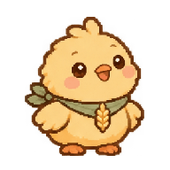

# 성경 이야기 친구들 · 기본 에셋 v2

FaithLog 앱의 정원·도감·뽑기 결과에 사용할 기본 정지 포즈 13종입니다.
승인된 다윗의 양 시안을 기준으로 이미지 생성 도구로 제작한 오리지널 캐릭터입니다.
GitAnimals의 원본 에셋을 복사하지 않았습니다. 기존 5종은 성경 이야기에서 영감을 받았고, 새 8종은 소망·말씀·온유·동행·기쁨·평안·사랑·인내를 표현하는 창작 친구입니다. 특정 성경 인물이나 동물을 의미하지 않습니다.
요나 이야기의 큰 물고기를 고래로 표현한 것은 캐릭터 디자인 선택입니다.

| ID | 이름 | 기본 PNG |
| --- | --- | --- |
| `david-lamb` | 다윗의 양 |  |
| `noah-bear` | 노아의 곰 |  |
| `jonah-whale` | 요나의 고래 |  |
| `daniel-lion` | 다니엘의 사자 |  |
| `peace-dove` | 평화의 비둘기 |  |
| `hope-rabbit` | 소망 토끼 |  |
| `word-fox` | 말씀 여우 |  |
| `gentle-deer` | 온유 사슴 |  |
| `companion-donkey` | 동행 당나귀 |  |
| `joy-chick` | 기쁨 병아리 |  |
| `peace-penguin` | 평안 펭귄 |  |
| `love-otter` | 사랑 수달 |  |
| `patience-turtle` | 인내 거북이 |  |

## React Native에서 사용

```tsx
import { Image } from 'react-native';
import { BIBLE_FRIENDS } from './src/characters/bibleFriends';

const friend = BIBLE_FRIENDS[0];

<Image
  source={friend.source}
  accessibilityLabel={friend.name}
  resizeMode="contain"
  style={{ width: 96, height: 96 }}
/>
```

예제 import는 저장소 루트의 컴포넌트 기준이며 실제 파일 위치에 맞춰 조정합니다.
목록은 Metro가 정적으로 수집할 수 있도록 리터럴 `require()`를 사용합니다.
동적 문자열 `require(path)`나 원격 URL이 필요하지 않습니다.

## 파일 규격과 적용 범위

- 각 PNG는 투명 배경이며 여백을 포함한 단일 기본 포즈입니다.
- 원본 크기·바이트 수는 `manifest.json`에 기록했습니다. 기본 PNG 13개의 합계는 약 3.53 MiB입니다.
- 기존 5종의 `*-idle.png`는 고해상도 기본 시안이고, 추가 8종은 192×192 기본 포즈입니다. 실제 모션에는 [motions/README.md](motions/README.md)의 정규화된 192×192 PNG 208장을 사용합니다.
- `contain`으로 표시하고 동일한 컨테이너를 사용합니다. 64~128dp에서 실기기 가독성을 확인한 뒤, 실제 산책 UI에서는 개체별 보이는 크기와 바닥 기준선을 맞춥니다.
- `reference/david-lamb-poses-concept.png`는 앞서 승인된 기본·걷기·터치·들림 **참고 시트**입니다. 등간격 프레임이 아니므로 런타임 애니메이션 시트로 사용하지 않습니다. 목록에서도 참조하지 않습니다.
- 기본 이미지 목록은 `bibleFriends.ts`, 모션 이미지 목록은 `bibleFriendMotionAssets.ts`, 프레임 시간 계산은 `bibleFriendMotionTimeline.ts`에서 제공합니다.
- 앱 홈 화면, 포인트, 뽑기 확률 및 터치/드래그 이벤트는 아직 연결하지 않습니다. 모션 에셋과 타이밍을 제공하는 단계입니다.

## 제작 기준

따뜻한 갈색 외곽선, 둥근 아기 동물 비율, 복숭아색 볼, 세이지색 천과 금색 소품을 공유합니다.
캐릭터별 제작 지시는 각각 양(망토·수금), 곰(두건·방주), 고래(목도리·물줄기), 사자(크림색 옷·기도하는 앞발), 비둘기(올리브 잎·깃털 장식)입니다.
이미지는 내장 이미지 생성 도구로 제작했고 원본을 보존했습니다.

## 추가 기본형 8종

새 8종의 기본 PNG는 정규화된 `idle-0.png`와 동일한 192×192 파일입니다. 대기 모션과 같은 외형으로 시작하며 별도 의상 버전은 포함하지 않습니다.

## 수집형 의상 디자인

[designs/README.md](designs/README.md)에 각 동물의 기본형 포함 10개 디자인, 총 130종과 확률 초안을 정리했습니다.
신규 의상 117장은 별도 투명 PNG이며, 전용 유니크는 동물마다 1개씩 총 13종입니다.
의상별 모션은 아직 없으므로 해당 카탈로그의 `animationReady`를 확인합니다.
