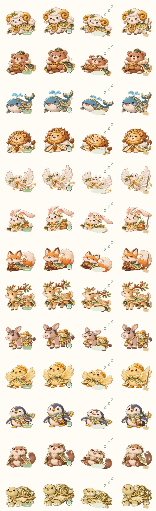

# FaithLog 진화형 13종 · 실제 돌봄 행동 PNG (Issue #342)



이 경로에는 **13종 × Lv.2/Lv.3 × 11개 행동 = 실제 PNG 아틀라스 286개**가 있습니다. 각 파일은 가로로 이어진 **4개의 192×192 투명 PNG 프레임**(전체 768×192)이므로 총 **1,144개의 재생 프레임**을 제공합니다.

| 행동 | 이미지 요소 | 프레임 |
| --- | --- | --- |
| feed | 몸을 숙이고 그릇·먹이·입 앞 음식 표현 | 4 |
| play | 공 따라 점프, 공과 반짝임 위치 변경 | 4 |
| sleep | 눕고 눈 감는 오버페인트, 숨쉬기·Zzz | 4 |
| wake | 기상하며 몸을 일으키고 빛살 등장 | 4 |
| pet | 머리 쓰다듬는 손과 하트 변화 | 4 |
| dirty | 웅크리고 배변 및 증기 연출 | 4 |
| clean | 빗자루 움직임, 거품 및 반짝임 | 4 |
| hungry | 배고픈 동작과 빈 그릇 | 4 |
| sick | 기운 없는 자세, 땀·붕대·치료 표시 | 4 |
| faint | 넘어지는 자세와 빙글 도는 별 | 4 |
| evolve | 진화 시 확대·빛 고리·반짝임 | 4 |

## 실제 제작 방식과 한계

**이전의 SVG 장식만 추가한 파일이나 기존 로열 의상 복사본이 아닙니다.** 앞선 #340의 **진화 전용 고해상도 PNG 원화 26종**을 사용해 몸의 기울기·크기·자세를 바꾸고, 먹이그릇·공·수면 눈·손·배변·청소도구 등 새로운 그래픽을 **각 프레임에 직접 그려 합성**했습니다.

단, **26개 기본 몸체를 바탕으로 한 합성 애니메이션**이며 1,144장의 몸통/팔/다리 원화를 모두 독립적으로 손그린 것은 아닙니다. 종별 먹이 씹는 입이나 발 움직임까지 일러스트레이터 수준으로 완전히 새로 그리는 작업은 추가 고도화가 필요합니다.

## 적용 및 재생

- 앱 컴포넌트: `src/characters/EvolvedCareActionSprite.tsx`
- 정적 Metro 번들: `src/characters/evolvedCareAtlasAssets.ts` (286개 require)
- 재생/정지: `src/characters/productionCareMotion.ts` (180ms/프레임, 지속상태 loop, 상호작용 마지막 프레임 hold)
- 기본형 진화 단계 1/2에서 동작 실행 시 `BibleFriendFarmSprite`가 신규 PNG를 렌더링합니다. 기본형 Lv1, 수집 코스튬, 예수님 미라클 및 미획득 실루엣은 유지합니다.
- 홈/동물농장 돌봄 버튼과의 **실제 사용자 데이터 상태 연결**, 먹이 소모/친밀도·진화 조건의 서버 구현, 실기기 시각 QA, main 스토어 배포는 본 이미지 작업과 별개입니다.

실제 PNG를 눈으로 보려면 [미리보기 HTML](./preview.html)을 로컬 서버에서 열거나 이 README의 contact-sheet를 확인하세요. PNG 파일은 전부 GitHub 바이너리로 저장되며 외부 이미지 검색 서비스에 의존하지 않습니다.

### 재생산

```bash
python3 -m pip install Pillow
python3 tools/generate_faithlog_care_atlases.py --root .
```

생성 후 이미지 검증은 `.github/workflows/generate-evolved-care-assets.yml`에서 수행됩니다.

## 출시 전 실기기 검수 항목

- 홈/동물농장 화면에서 실제 상태 변경으로 새 행동 PNG가 호출되는지 확인
- iOS/Android 작은 화면에서 발·뿔·소품이 잘리지 않는지 확인
- 동시에 5마리를 렌더링할 때 메모리 사용량과 프레임 드롭 측정
- 종별 눈 감는 오버페인트 위치를 시각 검수하고 필요하면 직접 보정
- 현재 11종 행동은 PNG로 생성됐지만 서버 먹이/배변/진화 조건 연결은 별도임
