# FaithLog 진화 캐릭터 · 실제 PNG 이미지 미리보기

**주의:** 26개 PNG는 기존 수집용 로열/유니크 디자인을 재사용한 임시 고화질 이미지입니다. 새로운 몸체를 다시 그린 최종 진화 원화는 아닙니다. GitHub에서 직접 렌더링하므로 외부 이미지 검색에 의존하지 않습니다.

| 캐릭터 | Lv.2 (기존 로열 아트) | Lv.3 (기존 유니크 아트) |
| --- | --- | --- |
| 다윗의 양 | 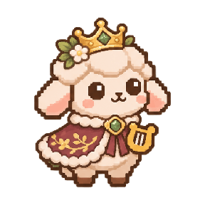 | 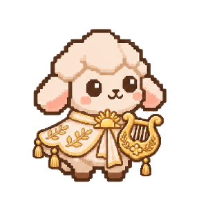 |
| 노아의 곰 | 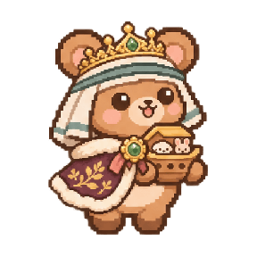 | 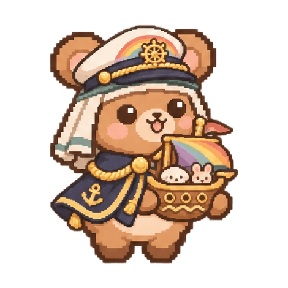 |
| 요나의 고래 | 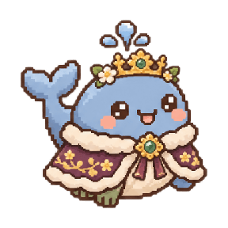 | 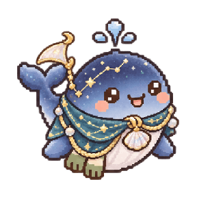 |
| 다니엘의 사자 | 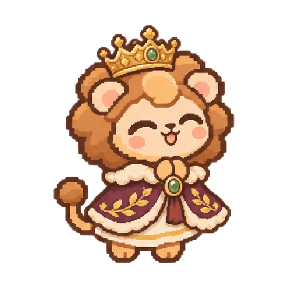 | 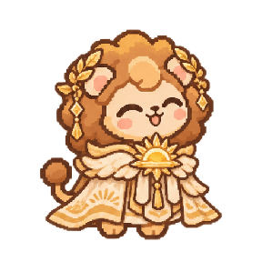 |
| 평화의 비둘기 | 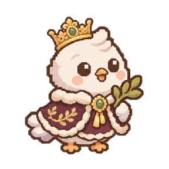 | 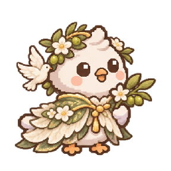 |
| 소망 토끼 | 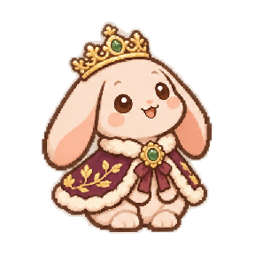 | 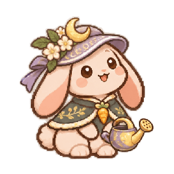 |
| 말씀 여우 | 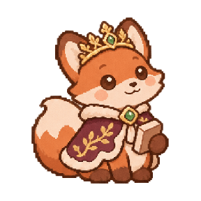 | 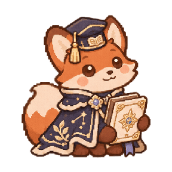 |
| 온유 사슴 | 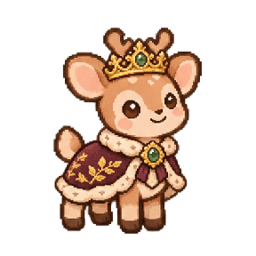 | 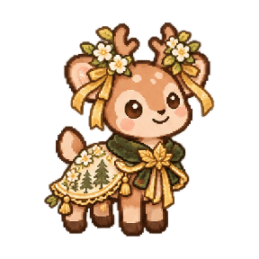 |
| 동행 당나귀 | 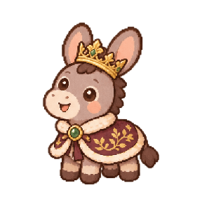 | 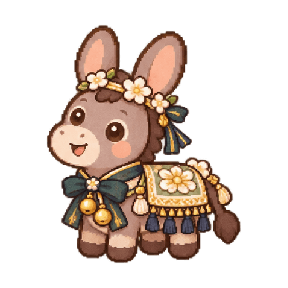 |
| 기쁨 병아리 | 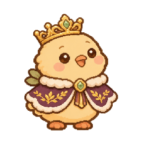 | 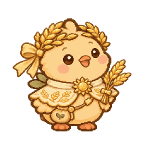 |
| 평안 펭귄 | 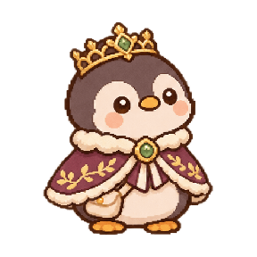 |  |
| 사랑 수달 | 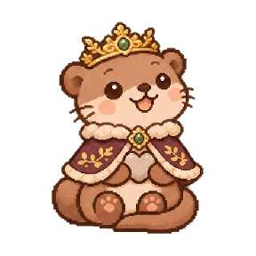 | 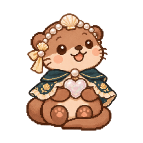 |
| 인내 거북이 | 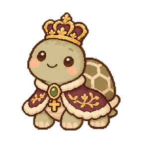 | 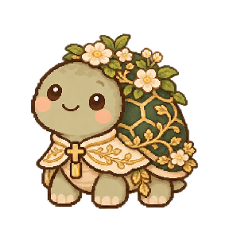 |

진화 단계를 캐릭터마다 새로 그린 최종 전신 PNG와 행동별 고유 포즈, 홈/서버 연동은 **미완료**입니다. 기존 SVG 프로토타입 182개는 보존하며 사용자용 미리보기에는 우선 기존 고화질 에셋을 사용합니다.
