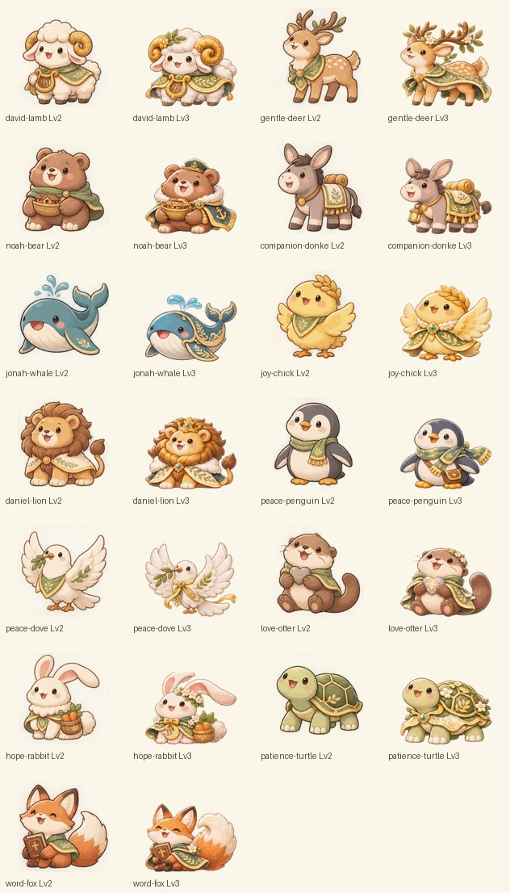

# FaithLog 진화 캐릭터 — 실제 앱용 PNG 에셋 (Issue #340)

**13종 × 진화 2단계 = 신규 캐릭터 원화 26개**를 기반으로 제작한 **PNG 아틀라스 26개**가 들어 있습니다. 이전 `royal`/`unique` 코스튬을 복제해 표시하던 임시 대체 방식을 중단하고, FaithLog의 기존 수집 캐릭터와 같은 둥근 일러스트 스타일의 **진화 전용 원화**를 사용합니다.

## 실제 파일

- 파일명: `<speciesId>-lv2.png`, `<speciesId>-lv3.png` × 13종
- PNG: 768 × 768, 투명 배경, 한 칸 192 × 192, 4열 × 4행, 아래 피벗 (96,176)
- 각 레벨마다 다른 전신 원화 1개를 **16개의 변환 모션 프레임**(눈에 띄는 걷기/기쁨/들기/착지 동작)으로 만든 아틀라스
- 모션 슬롯: idle(0–3), walk(4–7), happy(8–11), held(12–13), land(14–15)
- 시간 배분은 기존 `bibleFriendMotionTimeline.ts` 정책을 그대로 사용
- 먹이·놀이·잠자기·청소 등의 **돌봄 이펙트는 기존 farm SVG와 합성**함. 행동마다 별도로 손그린 16개 포즈는 아님

## 앱 적용

`src/characters/ProductionEvolvedSprite.tsx`에서 `productionEvolvedAssets.ts`의 26개 정적 `require`로 이미지를 묶습니다. 기존 `BibleFriendFarmSprite`가 `evolutionStage=1|2`인 **기본 디자인**만 신규 아틀라스로 렌더링합니다. Lv1·다른 의상 117종·미획득 실루엣·예수님 미라클은 바뀌지 않습니다.

기존 SVG 연구용 키포즈 182개는 삭제하지 않았지만 기본형의 진화 렌더러에서는 사용하지 않습니다. 

## 검수

GitHub에서 위 contact-sheet 이미지를 클릭하면 캐릭터 26종을 바로 볼 수 있습니다. 로컬에서는 저장소 루트에서 `python3 -m http.server 8080` 실행 후 `/assets/characters/bible-friends/evolved/production/preview.html`을 엽니다.

**미완료**: 캐릭터 고유 먹기·수면 손그림 원화, 홈 화면 진화 상태/API 전달, 실기기 시각 검수 및 운영 배포. 이미지 에셋 생성은 완료했지만 진화 시스템 기능 구현까지 완료했다는 뜻은 아닙니다.
